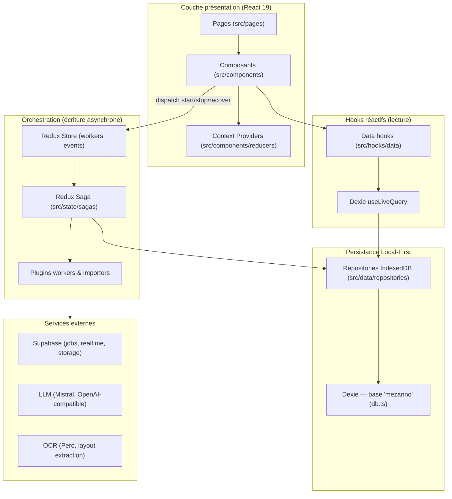

# Architecture — CorpuSense

_Spécification technique de référence. Dernière vérification contre le code : 2026-10-12. Les décisions sous-jacentes sont dans [DECISIONS.md](./DECISIONS.md)._

## 1. Rôle du projet

**CorpuSense** est une application web _Local-First_ d'ingénierie documentaire pour les humanités numériques : import de manifests [IIIF](https://iiif.io/) (URL, ARK Gallica, JSON collé, fichiers locaux), organisation de collections de canvas, annotation vectorielle de zones d'intérêt (W3C Web Annotation), traitements automatiques (OCR, extraction de layout, extraction structurée par LLM) et export de données (CSV, JSON, XLSX, Zip, W3C/IIIF).

Cas d'usage détaillés : [public/doc/usecase.md](../public/doc/usecase.md). Manuel utilisateur : [public/doc/howto.md](../public/doc/howto.md).

Le produit reste **desktop-first** : les écrans visent des fenêtres d'environ 800 px de large ou plus. À ce point de rupture, les barres d'outils doivent rester utilisables (retour à la ligne) et les tables devoir défiler horizontalement ; aucune adaptation mobile n'est planifiée (conventions UI : [developpement.md §4](./developpement.md), décision D-012).

## 2. Stack technique

| Domaine         | Choix                                                                                                   |
| --------------- | ------------------------------------------------------------------------------------------------------- |
| UI              | React 19, TypeScript 5.9, Tailwind CSS 4, Radix UI / Shadcn UI, Lucide React                            |
| Build           | Vite 7 (+ `vite-plugin-pwa`), Node 22 et npm 11.6.4 en CI                                               |
| Persistance     | Dexie v4 (IndexedDB, base `mezanno`), `dexie-react-hooks`, `dexie-observable` (addon actif, §7)         |
| Erreurs         | Result Pattern `FunctionResult<T, E>` (voir D-002)                                                      |
| État asynchrone | Redux Toolkit (allégé, sans logger) + Redux-Saga ; TanStack React Query v5 ; Zustand v5                 |
| Visualisation   | OpenSeaDragon, Annotorious 3 (`@annotorious/react`, `@annotorious/openseadragon`), dnd-kit              |
| IIIF            | `@iiif/presentation-3`, `@iiif/parser`                                                                  |
| PDF             | `@hyzyla/pdfium`, `pdfjs-dist`                                                                          |
| Services        | Supabase (jobs `cs_jobs` via Realtime, Storage, Auth), Mistral AI, OpenAI-compatible, Pero OCR, EmailJS |
| Tests           | Vitest + Testing Library + `fake-indexeddb` ; ESLint 9 ; Prettier 3                                     |

## 3. Architecture générale

CorpuSense suit un découpage strict en couches : l'UI ne parle jamais directement à la base, l'asynchrone lourd est orchestré par les sagas, et les traitements sont des plugins découverts dynamiquement.



Rôles :

1. **Bootstrap** (`src/main.tsx`, `src/App.tsx`) : initialise i18n, charge les plugins (`loadWorkerPlugins()`, `loadImporterPlugins()` via `import.meta.glob`, D-007), monte `BrowserRouter basename={VITE_BASE_PATH}` et la pile de providers.
2. **Lecture réactive** : les composants s'abonnent à IndexedDB via les hooks de `src/hooks/data/` (`useLiveCollections`, `useLiveSources`, `useAnnotationsForCanvas`…). Toute écriture en base rafraîchit l'IHM sans passage par Redux.
3. **Écriture et orchestration** : l'IHM dispatche des actions de commande (`startWorkerProcessRequest`, …) ; les sagas orchestrent, les plugins exécutent, les résultats sont persistés via les repositories ; Redux ne porte que le statut d'exécution et les notifications.
4. **Accès aux données** : jamais d'appel Dexie direct depuis l'UI — toujours un repository instancié par `dbFactory.ts` (D-004 ; interface de découplage non retenue, D-005).

### Organisation des composants React (D-009)

`src/components/` est organisé selon la responsabilité des composants :

| Dossier               | Contenu                                                                                    |
| --------------------- | ------------------------------------------------------------------------------------------ |
| `ui/`                 | Primitives génériques, notamment les composants shadcn, sans logique métier                |
| `common/`             | Composants applicatifs transversaux réutilisés par plusieurs domaines                      |
| `layout/`             | Shell de l'application et navigation transversale                                          |
| `features/<domaine>/` | Composants d'interface métier classés par domaine, avec styles/tests co-localisés si utile |
| `reducers/`           | Providers et contextes React transversaux                                                  |

Les pages restent dans `src/pages/` ; hooks, modèles, services et accès aux données gardent leurs couches propres. Cette organisation a été mise en place progressivement dans R7 ; elle ne justifie pas le déplacement mécanique des composants ou éléments techniques restants.

## 4. Gestion de l'état (résumé de D-001)

| Mécanisme         | Emplacement                             | Contenu                                                                                        |
| ----------------- | --------------------------------------- | ---------------------------------------------------------------------------------------------- |
| IndexedDB (Dexie) | `src/data/repositories/indexeddb/db.ts` | Toute la donnée métier persistante                                                             |
| Redux Toolkit     | `src/state/store.ts`                    | Exactement deux slices : `workers` (statut d'exécution) et `events` (toasts) ; thunk désactivé |
| React Context     | `src/components/reducers/`              | Session utilisateur, sélection courante, contexte d'annotation, contexte worker…               |
| Zustand           | `src/state/zustand/useFSHandleStore.ts` | `FileSystemFileHandle` de la File System Access API                                            |
| React Query       | `src/hooks/`                            | Fetching externe ponctuel (conversion PDF, miniatures)                                         |
| localStorage      | navigateur                              | Clés API (Mistral, OpenAI, GitHub), drapeaux expérimentaux                                     |

## 5. Flux principaux

### Flux 1 — Lecture réactive (standard)

Composant → hook de `src/hooks/data/` → repository (via `dbFactory`) → `useLiveQuery` observe les tables Dexie → re-rendu automatique à toute écriture.

### Flux 2 — Commande et Result Pattern

Composant/saga → méthode de repository faillible → `FunctionResult<T, E>` typé (`{ ok, value } | { ok, error }`) ; erreurs `BaseError` avec contexte JSON ; incidents IO non récupérables = exceptions capturées **une seule fois** au boundary. Règles complètes : D-002.

### Flux 3 — Orchestration d'un worker (local ou distribué)

```text
Clic « Lancer worker » → dispatch startWorkerProcessRequest
→ saga workers.ts : garde de statut → plugin.run(task)
→ plugin (mistral, openai, mistralOcr, peroocr, layoutExtraction, customWorker)
   • local : Web Worker / calcul navigateur
   • distribué : insert dans Supabase cs_jobs → statuts POSTING/POSTED
     → passerelle useJobRealtime (Realtime + repli en sondage périodique 20 s)
→ résultat persisté via ResultRepository → statut worker dérivé de la file
→ toast via eventsReducer → vue réactive mise à jour par Dexie
```

La loi des statuts worker/tâche est centralisée dans le module pur `workerStatusLaw.ts` (R1, D-008) : elle valide les transitions, dérive le statut worker depuis sa file et mappe les états Supabase. Repository, saga, bridge realtime et présentation UI s'appuient sur cette loi ou sur des tables de présentation exhaustives ; `patch()` ne permet pas de modifier le statut ni la file. La migration Dexie v31 → v32 convertit les anciens alphabets et rejette explicitement les valeurs persistées inconnues. Les détails des transitions et de l'interruption/reprise sont dans [statuts.md](./statuts.md). Les anciens plugins `tesseract`/`surya` ne sont plus chargés et sont conservés dans `archive/legacy-workers/` (Q5).

## 6. Plugins

- **Workers** (`src/state/sagas/plugins/workers/`, glob eager, filtre `experimental`) : `mistral.ts`, `openai.ts`, `mistralOcr.ts`, `peroocr.ts`, `layoutExtraction.ts`, `customWorker.ts`. Un plugin sait exécuter une tâche et exporter ses résultats.
- **Importers** (`importers/`) : `default.ts` (tout manifest IIIF v2/v3 par URL), `gallica.ts` (ARK BnF → manifest).
- Erreurs de plugin : sous-classes de `BaseError` nommant job/worker/URL (`plugins/errors.ts`).

## 7. Modèle de données

Vocabulaire du domaine : `CONTEXT.md` (racine). Schéma Dexie **version 34** (`db.ts`), avec migration des statuts worker/tâche depuis v31 :

| Store                                        | Clés/index                                                                     |
| -------------------------------------------- | ------------------------------------------------------------------------------ |
| `collections`                                | `&id, name, *tags.id`                                                          |
| `collectionContents`                         | `&id` (ordre = ordre du tableau `content`, v31)                                |
| `history`                                    | `&url`                                                                         |
| `storedManifests` / `storedManifestContents` | `&id, name` / `&id` (legacy, migration manuelle vers Sources)                  |
| `typesList`                                  | `&label`                                                                       |
| `itemMetadata`                               | `[id+attribute.label]`                                                         |
| `tags`                                       | `&id`                                                                          |
| `models`                                     | `&id, name`                                                                    |
| `annotations` / `annotationsTemp`            | `&id, canvasId, collectionId, [canvasId+collectionId], order, …`               |
| `namedEntities`                              | `&id, *annotationIds, type.id`                                                 |
| `results`                                    | `++id, workerName, workerId, [scopeKey+workerName], taskId, [workerId+taskId]` |
| `workers`                                    | `&id, name, status, [scopeKey+name]`                                           |
| `handles`                                    | `&id`                                                                          |
| `convertedFiles`                             | `&id, folderName`                                                              |
| `modifierChains`                             | `&id, name`                                                                    |
| `projects`                                   | `&id, name`                                                                    |
| `sources` / `sourceContents` / `storedBlobs` | `&id, name, type` / `&id` / `&id`                                              |

La v33 complète les horodatages et remplace les identifiants numériques historiques de `results`. La v34 est une migration de données sans changement de clés ni d'index : elle vérifie indépendamment `createdAt` et `updatedAt` dans tous les stores applicatifs du tableau `timestampedStores`. Les stores internes de l'addon `dexie-observable` (`_changes`, `_syncNodes`, `_intercomm`, `_uncommittedChanges`) en sont exclus : ils existent pourtant bel et bien dans la base — `import 'dexie-observable'` installe l'addon (`Dexie.addons.push`, exécuté à chaque construction d'instance Dexie, qui ajoute les stores au schéma, suit les changements et surcharge `db.open`/`db.close`) et il n'existe aucun appel d'activation à faire, `db.observable` n'étant qu'un espace de noms (`{version, SyncNode, sendMessage, broadcastMessage}`) — mais ces stores sont la propriété de l'addon, hors du typage applicatif. Une chaîne conforme à `z.iso.datetime()` est conservée ; un `Date` valide est converti en ISO UTC si le résultat est conforme. Les autres valeurs sont remplacées par un instant commun à la migration, sans prétendre restituer la date historique. La v34 ne modifie aucun autre champ ni identifiant ; les migrations précédentes conservent leurs propres effets. Aucune ligne n'est réécrite pour rien : une passe ne touche que les lignes dont le champ concerné est effectivement à réparer.

Les lignes portant une donnée annexe du navigateur — `Blob` ou `FileSystemDirectoryHandle` — ne sont **jamais** réécrites pendant une transaction de `versionchange` : le navigateur doit re-sérialiser ces payloads, l'écriture échoue (`DataError`), la transaction avorte et la base tout entière refuse de s'ouvrir. Sont concernées les lignes des stores de `binaryPayloadStores` (`handles`, `convertedFiles`, `storedBlobs`, dont le modèle met un payload dans chaque ligne) et, store par store, toute ligne dont l'exploration trouve un `Blob` ou un `FileSystemHandle` (`results`, `sourceContents`, …). Ces lignes sont comptées puis consignées dans `localStorage` (`mezanno-timestamps-deferred-stores`) ; `repairDeferredTimestamps`, appelé au démarrage par le saga racine, les répare ensuite dans des transactions ordinaires, une par une, transaction marquée migration pour ne pas re-stamper `updatedAt`. Un payload illisible ne fait donc échouer que sa propre ligne, jamais l'ouverture de la base ; sans ligne en attente, cet appel ne touche pas IndexedDB. Si `localStorage` est indisponible ou vidé, ces lignes gardent leurs dates absentes jusqu'à leur prochaine écriture, que les hooks remplissent alors.

Le coût d'une réécriture générale est en outre doublé par l'addon `dexie-observable` : toute mutation d'un store applicatif produit aussi une ligne dans `_changes` (journal des changements), donc une migration qui touche toutes les lignes écrit deux fois plus qu'il n'y paraît. C'est une raison de plus, indépendante du `DataError`, d'écrire seulement les lignes à réparer.

La restauration de sauvegardes Dexie accepte explicitement les versions 32, 33 et courante (34), pas les versions antérieures. Avant insertion, elle normalise les dates selon les mêmes règles et conserve la conversion existante des identifiants historiques ; l'effacement et l'insertion sont transactionnels. Les types applicatifs exigent désormais les deux dates pour toute entité héritant de `TimeStampSchema` : les schémas Zod des entités persistées (collections, sources et contenus, blobs, annotations, modèles, tags, workers, résultats, projets, handles, métadonnées, historique, et désormais `modifierChains`, séparée d'un DTO d'entrée sans dates) déclarent `createdAt` et `updatedAt` en `z.iso.datetime()` obligatoires, et `WorkerSchema` les hérite sans redéfinition affaiblissante ; les données antérieures sont réparées par les migrations, pas au vol à la lecture. Seul `typesList` (store vestigial sans table typée ni écriture applicative identifiée) reste couvert uniquement par la v34 et les hooks, sans typage.

Les horodatages sont posés par les fonctions des repositories : à la création, les deux dates sont initialisées à l'écriture ; à la modification, `updatedAt` est posé par le repository et `createdAt` conserve la valeur stockée. Les DTO d'entrée des repositories n'ont aucun champ `createdAt`/`updatedAt`. Les hooks Dexie (`creating`/`updating`) restent un filet tolérant (ils remplissent les dates absentes et conservent toute chaîne non vide) pour les écritures qui n'empruntent aucun repository : écritures directes de test, migrations, restauration de sauvegardes. Les objets retournés par les repositories correspondent aux valeurs effectivement persistées (relus après écriture sur les voies concernées : sources, workers, annotations permanentes et temporaires, collections). La migration manuelle `migrateAllSources` conserve les dates des lignes legacy ; le retrait d'un élément inexistant d'une collection n'écrit rien et n'avance pas `updatedAt`.

L'import applicatif accepte les collections JSON actuelles (avec `sources`) et historiques (éléments à `position`, avec résolution des manifestes), individuellement ou dans un ZIP, ainsi que les modèles JSON autonomes. Avant validation, il répare les horodatages de la collection, des sources et de leurs contenus, des tags, annotations, modèles, workers et résultats présents, selon les mêmes règles ; l'instant de substitution est commun à l'import d'un fichier ou d'un ZIP. Les dates valides sont conservées et les identifiants numériques historiques de résultats sont remplacés par des UUID. Les manifestes IIIF et autres objets métier imbriqués ne sont pas parcourus. Les autres validations existantes restent inchangées : notamment les annotations utilisent toujours un schéma personnalisé sans validation structurelle complète. Les exports de collection incluent désormais `sources: []` même sans source. Les sources locales sérialisées en JSON restent soumises à la validation existante de leur handle de répertoire, qui n'est pas reconstitué par JSON.

Les voies d'import capables d'écraser une ligne existante empruntent une écriture dédiée transactionnelle marquée comme migration (`importWithDates` sur les modèles, annotations permanentes, annotations temporaires et étiquettes) : les dates de l'entité importée y sont validées (`z.iso.datetime()`) et préservées telles quelles, sans re-stampage par les hooks ordinaires ; des dates invalides sur cette voie sont refusées et remontées en échec `FunctionResult` avec un message traduit (`error_invalid_imported_dates`), la ligne existante restant inchangée.

Conventions des modèles (`src/data/models/`) : séparation `*Details` (métadonnées légères) / `*Content` (payload lourd) ; types DTO dans des fichiers `*.dto.ts` distincts des types d'entité, le couple étant placé dans un sous-dossier quand les deux fichiers existent (ex. `collection/collection.ts` et `collection/collection.dto.ts`) ; `*CreateDTO` en entrée d'écriture ; schémas Zod (`z.infer`) pour les entités complexes ; annotations conformes au W3C Web Annotation Data Model (motivations `classifying` + `tagging`).

## 8. Routage

Routes déclarées dans `CorpusenseRoutes` (`src/hooks/useAppNavigation.tsx`) et montées dans `App.tsx` sous `Layout` :

| Chemin                       | Page                       | Rôle                                     |
| ---------------------------- | -------------------------- | ---------------------------------------- |
| `/`                          | `Home`                     | Accueil                                  |
| `/manifest`                  | `ManifestExplorerPage`     | Explorateur de manifests IIIF            |
| `/project`                   | `ProjectPage`              | Projets                                  |
| `/collections`               | `CollectionsManagerPage`   | Gestion des collections                  |
| `/collections/:collectionId` | `CollectionInspectorPage`  | Inspection, annotation, workers          |
| `/models`                    | `ModelsManagerPage`        | Éditeur de modèles de données            |
| `/modifier-chain`            | `ModifierChainManagerPage` | Chaînes de modificateurs                 |
| `/localSources`              | `StoragePage`              | Stockage local et sources importées      |
| `/iiifSources`               | `IIIFSourcesPage`          | Sources IIIF                             |
| `/workers`                   | `WorkersManagerPage`       | Suivi et configuration des workers       |
| `/configuration`             | `ConfigurationPage`        | Clés API et préférences                  |
| `/doc` `/doc/:page`          | `DocumentationPage`        | Visualiseur Markdown (lit `public/doc/`) |
| `/expert`                    | `ExpertPage`               | Mode expert                              |

L'application est mono-utilisateur locale : pas de garde de routes, décision documentée en D-011.

## 9. Configuration

Variables lues via `import.meta.env` (`src/utils/config.ts`) :

| Variable                                                                     | Rôle                                                                           | Défaut    |
| ---------------------------------------------------------------------------- | ------------------------------------------------------------------------------ | --------- |
| `VITE_BASE_PATH`                                                             | Sous-répertoire d'hébergement (router, assets, PWA)                            | `/`       |
| `VITE_SUPABASE_URL` / `VITE_SUPABASE_ANON_KEY` / `VITE_SUPABASE_STORAGE_URL` | Instance Supabase (jobs, storage)                                              | —         |
| `VITE_EMAILJS_PUBLIC_KEY` / `_SERVICE_ID` / `_TEMPLATE_ID`                   | Formulaire de contact                                                          | optionnel |
| `VITE_APP_VERSION` / `VITE_BUILD_DATE` / `VITE_GIT_HASH`                     | Version injectée par Vite ; date et hash générés par `scripts/generate-env.js` | —         |

Le client Supabase est créé au chargement du module : une URL valide et une clé anon non vide sont nécessaires au démarrage, même sans utiliser les jobs distants. La CI de déploiement exige les sept variables de configuration de déploiement listées dans le [README](../README.md#télécharger-et-déployer-simplement). Toutes les variables `VITE_*` sont publiques dans le bundle. Les clés API utilisateur (Mistral, OpenAI, GitHub PAT) sont saisies dans la page de configuration et stockées en `localStorage` (D-011, registre S-04).

## 10. Build & déploiement

```text
npm run build → scripts/generate-env.js → tsc -b → vite build → dist/
push develop → validation → build → artefact Pages → déploiement GitHub Pages
```

La PWA est générée par `vite-plugin-pwa`. `manualChunks` (vite.config.ts) isole les gros paquets (`@annotorious/*`, `@samvera/clover-iiif`). La CI vérifie types, tests, format et lint ratchet sur les PR et avant déploiement ; l'audit des dépendances est non bloquant. Les E2E ne tournent que sur les PR ; leur caractère obligatoire à la fusion dépend de la protection de branche (Q3/Q9).
